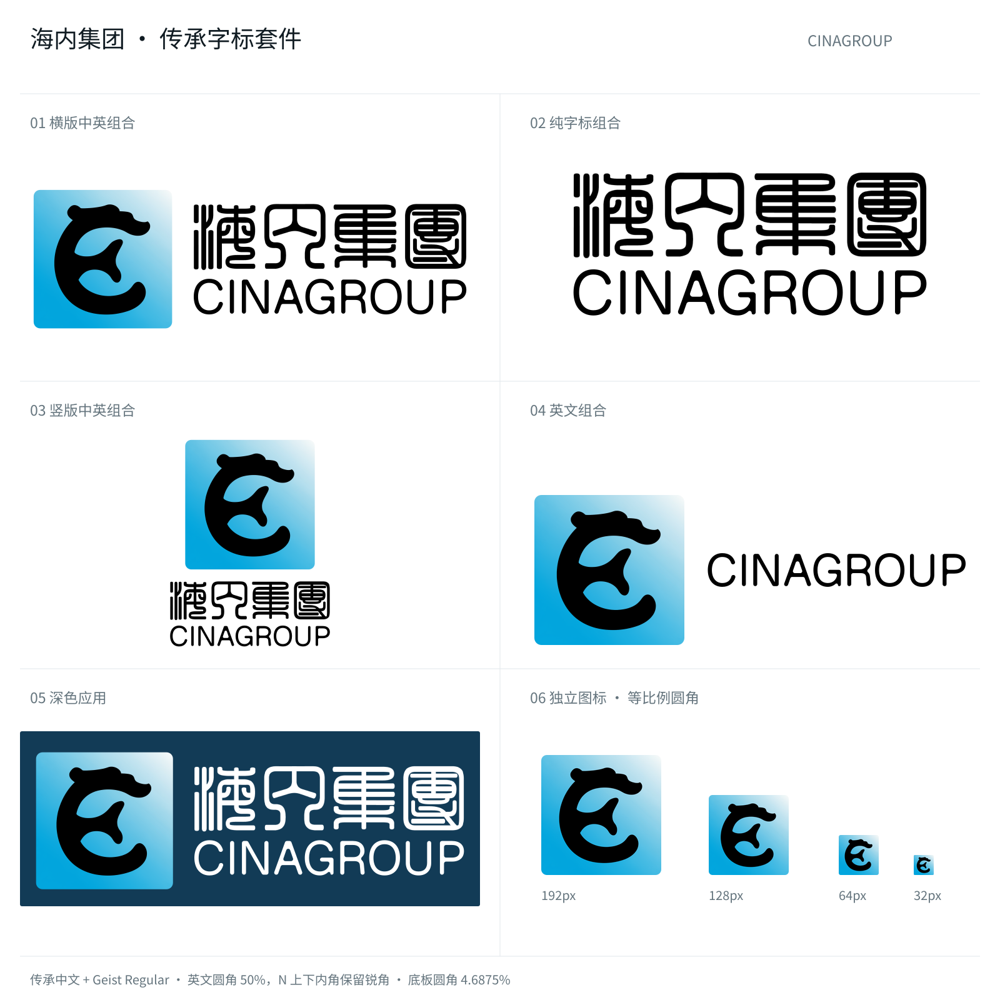
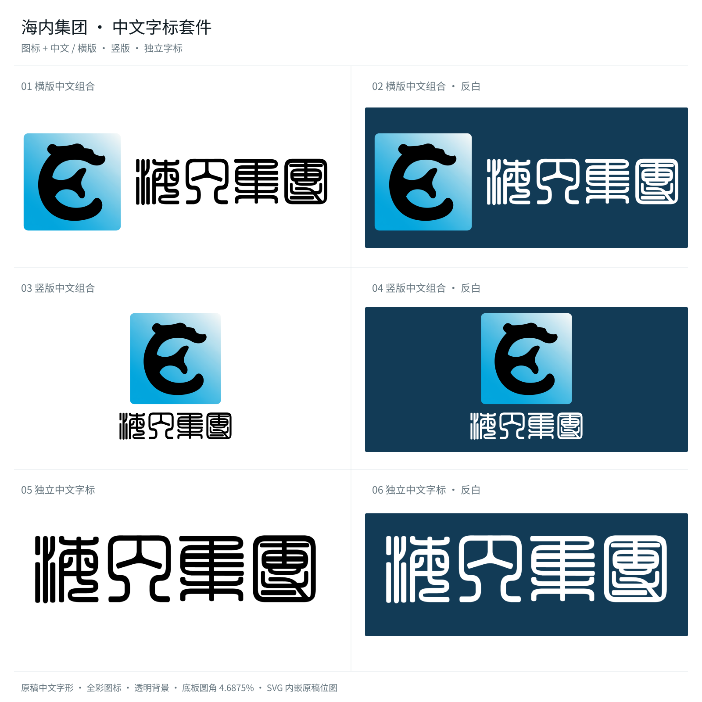
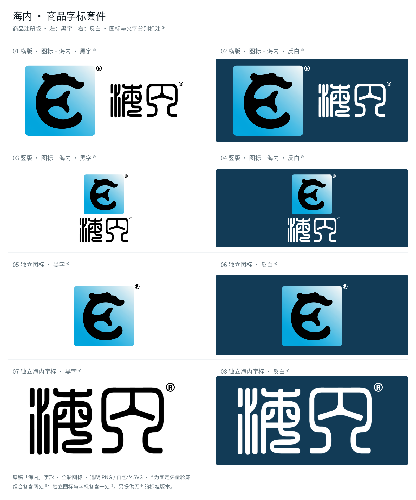
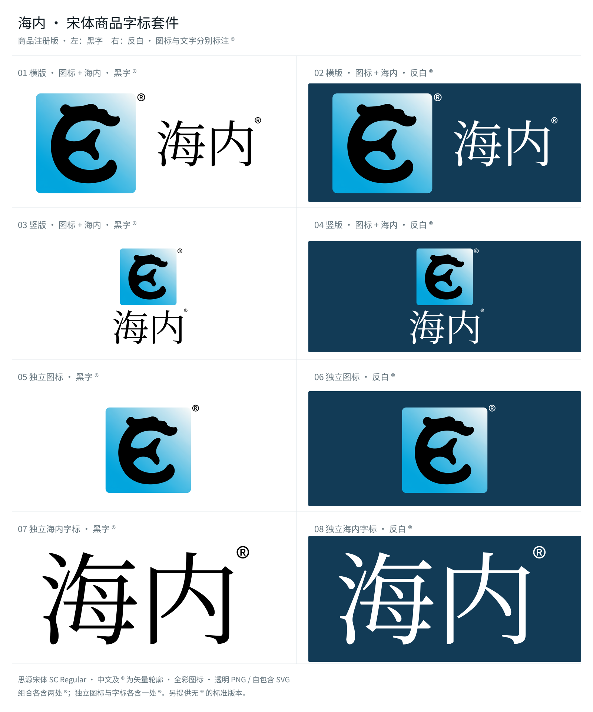

# 海内集团 CinaGroup Brand

海内集团官方通用品牌资产仓库。当前集团标准为 **v2.1.1 传承中文 + Geist 英文**：保留原始左侧图案、蓝色渐变与中文字形，英文 CINAGROUP 使用 **Geist Regular** 轮廓，尖角采用主笔画宽度 **50%** 的圆角半径，**N 字上下内侧的两处锐角保留原状**。中英双行组合等宽、左右对齐，蓝色底板采用边长 **4.6875%** 的等比例圆角。



## 传承字标套件

| 用途 | PNG | SVG | 原生尺寸 |
| --- | --- | --- | --- |
| 横版中英组合 | [下载](assets/heritage/cinagroup-horizontal.png) | [下载](assets/heritage/cinagroup-horizontal.svg) | 3328 × 1152 |
| 竖版中英组合 | [下载](assets/heritage/cinagroup-stacked.png) | [下载](assets/heritage/cinagroup-stacked.svg) | 1408 × 1664 |
| 英文组合 | [下载](assets/heritage/cinagroup-english.png) | [下载](assets/heritage/cinagroup-english.svg) | 3072 × 1152 |
| 纯字标组合 | [下载](assets/heritage/cinagroup-wordmark.png) | [下载](assets/heritage/cinagroup-wordmark.svg) | 2176 × 960 |

每种组合还提供 `-white` 文字反白版本，以及四分之一宽度的 PNG，例如 [`cinagroup-horizontal-832.png`](assets/heritage/cinagroup-horizontal-832.png)。含图标的组合保留左侧全彩原图；反白版本仅改变文字颜色。组合 SVG 自包含图形和中文位图，英文采用矢量路径；**整张组合不是纯矢量稿**，显示时不依赖本机字体。

独立素材：[左侧原图](assets/heritage/cinagroup-symbol-source.png)、[中文原字标](assets/heritage/cinagroup-wordmark-zh.png)、[Geist 圆角英文 PNG](assets/heritage/cinagroup-wordmark-en.png)、[英文纯矢量 SVG](assets/heritage/cinagroup-wordmark-en.svg)。完整文件、尺寸与校验值见 [套件清单](assets/heritage/manifest.json)。

英文采用官方 Geist v1.7.2 的 Regular（400）字重；以大写 I 的 86 字体单位笔画为基准，圆角半径为 43 单位。狭窄接点局部缩小半径，避免相邻圆角重叠。字体、来源校验值与 OFL 许可证保存在 [字体源目录](sources/fonts/geist/README.md)。

## 图标 + 中文套件

保留核准的全彩图标与“海内集团”原中文字形，提供不含英文的横版、竖版组合，以及可单独使用的中文字标。深色背景使用文字反白版本，图标仍保持原始全彩。



| 组合 | 黑字 PNG / SVG | 反白 PNG / SVG | 原生尺寸 | 小尺寸 PNG（黑字 / 反白） |
| --- | --- | --- | --- | --- |
| 横版图标 + 中文 | [PNG](assets/heritage/cinagroup-chinese.png) / [SVG](assets/heritage/cinagroup-chinese.svg) | [PNG](assets/heritage/cinagroup-chinese-white.png) / [SVG](assets/heritage/cinagroup-chinese-white.svg) | 3328 × 1152 | [832 × 288](assets/heritage/cinagroup-chinese-832.png) / [反白](assets/heritage/cinagroup-chinese-white-832.png) |
| 竖版图标 + 中文 | [PNG](assets/heritage/cinagroup-chinese-stacked.png) / [SVG](assets/heritage/cinagroup-chinese-stacked.svg) | [PNG](assets/heritage/cinagroup-chinese-stacked-white.png) / [SVG](assets/heritage/cinagroup-chinese-stacked-white.svg) | 1408 × 1472 | [352 × 368](assets/heritage/cinagroup-chinese-stacked-352.png) / [反白](assets/heritage/cinagroup-chinese-stacked-white-352.png) |

| 独立中文字标 | PNG | SVG | 512px PNG |
| --- | --- | --- | --- |
| 黑字 | [2027 × 493](assets/heritage/cinagroup-wordmark-zh.png) | [下载](assets/heritage/cinagroup-wordmark-zh.svg) | [512 × 125](assets/heritage/cinagroup-wordmark-zh-512.png) |
| 反白 | [2027 × 493](assets/heritage/cinagroup-wordmark-zh-white.png) | [下载](assets/heritage/cinagroup-wordmark-zh-white.svg) | [512 × 125](assets/heritage/cinagroup-wordmark-zh-white-512.png) |

中文 SVG 内嵌原稿提取的透明 PNG，保留原字形，不含英文字标，也不依赖字体；它是自包含的位图封装，**不是中文矢量轮廓**。独立中文字标不含图标。PNG 均使用透明背景，所有文字按原比例缩放。

本次新增文件先使用本地路径；合并后可使用 `main` 路径。现有 `v2.1.1` 固定版本示例对应已发布资产，新增文件须待后续标签发布后再固定版本引用。

## 海内 · 商品字标套件

“海内”直接取自原中文字标的前两字，保留原字形，并与核准的全彩图标组合。提供基础版与带注册标记的 `-registered` 版：注册组合的图标与文字各有一处 ®，独立图标和独立字标各有一处 ®。



| 版式 | 原生尺寸 | 基础版 PNG / SVG | 基础反白 PNG / SVG | ® 版 PNG / SVG | ® 反白 PNG / SVG |
| --- | --- | --- | --- | --- | --- |
| 横版图标 + 海内 | 2432 × 1152 | [PNG](assets/hainei/hainei-horizontal.png) / [SVG](assets/hainei/hainei-horizontal.svg) | [PNG](assets/hainei/hainei-horizontal-white.png) / [SVG](assets/hainei/hainei-horizontal-white.svg) | [PNG](assets/hainei/hainei-horizontal-registered.png) / [SVG](assets/hainei/hainei-horizontal-registered.svg) | [PNG](assets/hainei/hainei-horizontal-registered-white.png) / [SVG](assets/hainei/hainei-horizontal-registered-white.svg) |
| 竖版图标 + 海内 | 1408 × 1792 | [PNG](assets/hainei/hainei-stacked.png) / [SVG](assets/hainei/hainei-stacked.svg) | [PNG](assets/hainei/hainei-stacked-white.png) / [SVG](assets/hainei/hainei-stacked-white.svg) | [PNG](assets/hainei/hainei-stacked-registered.png) / [SVG](assets/hainei/hainei-stacked-registered.svg) | [PNG](assets/hainei/hainei-stacked-registered-white.png) / [SVG](assets/hainei/hainei-stacked-registered-white.svg) |
| 独立海内字标 | 1216 × 640 | [PNG](assets/hainei/hainei-wordmark.png) / [SVG](assets/hainei/hainei-wordmark.svg) | [PNG](assets/hainei/hainei-wordmark-white.png) / [SVG](assets/hainei/hainei-wordmark-white.svg) | [PNG](assets/hainei/hainei-wordmark-registered.png) / [SVG](assets/hainei/hainei-wordmark-registered.svg) | [PNG](assets/hainei/hainei-wordmark-registered-white.png) / [SVG](assets/hainei/hainei-wordmark-registered-white.svg) |
| 独立全彩图标 | 1280 × 1280 | [PNG](assets/hainei/hainei-symbol.png) / [SVG](assets/hainei/hainei-symbol.svg) | — | [PNG](assets/hainei/hainei-symbol-registered.png) / [SVG](assets/hainei/hainei-symbol-registered.svg) | [PNG](assets/hainei/hainei-symbol-registered-white.png) / [SVG](assets/hainei/hainei-symbol-registered-white.svg) |

各版式另有四分之一宽度的透明 PNG，注册版可直接下载：

| 版式 | 黑字 / 黑色 ® | 反白文字 / 白色 ® |
| --- | --- | --- |
| 横版 · 608 × 288 | [下载](assets/hainei/hainei-horizontal-registered-608.png) | [下载](assets/hainei/hainei-horizontal-registered-white-608.png) |
| 竖版 · 352 × 448 | [下载](assets/hainei/hainei-stacked-registered-352.png) | [下载](assets/hainei/hainei-stacked-registered-white-352.png) |
| 独立字标 · 304 × 160 | [下载](assets/hainei/hainei-wordmark-registered-304.png) | [下载](assets/hainei/hainei-wordmark-registered-white-304.png) |
| 独立图标 · 320 × 320 | [下载](assets/hainei/hainei-symbol-registered-320.png) | [下载](assets/hainei/hainei-symbol-registered-white-320.png) |

反白版仅将文字和 ® 改为白色，全彩图标保持原样；独立图标反白版只改变 ® 的颜色。® 使用固定版本 Geist 的矢量轮廓，不依赖字体。SVG 内嵌原图标与“海内”位图，**不是完整的纯矢量稿**。

商品包装、吊牌和标签使用时保留完整画布及右上方 ® 的留白，不裁到图标或文字边缘。原字形裁片见 [981 × 493px 原稿](assets/hainei/hainei-wordmark-source.png)，完整文件、布局及校验值见 [海内套件清单](assets/hainei/manifest.json)。新增海内文件先使用本地路径，合并后可使用 `main`；现有 `v2.1.1` 标签与 CDN 示例不变，新增资产待后续标签发布后再固定版本引用。

## 海内 · 仿宋商品字标套件

“海内”使用固定版本 **朱雀仿宋 Regular v0.212** 的原始字形轮廓，图标与文字分别在右上方标注 ®。字体来源、官方归档校验值和 OFL 许可证见[字体说明](sources/fonts/zhuque-fangsong/README.md)。


| 版式 | 原生尺寸 | ® 黑字 PNG / SVG | ® 反白 PNG / SVG | 小尺寸 PNG（黑字 / 反白） |
| --- | --- | --- | --- | --- |
| 横版图标 + 海内 | 2432 × 1152 | [PNG](assets/hainei-fangsong/hainei-fangsong-horizontal-registered.png) / [SVG](assets/hainei-fangsong/hainei-fangsong-horizontal-registered.svg) | [PNG](assets/hainei-fangsong/hainei-fangsong-horizontal-registered-white.png) / [SVG](assets/hainei-fangsong/hainei-fangsong-horizontal-registered-white.svg) | [608 × 288](assets/hainei-fangsong/hainei-fangsong-horizontal-registered-608.png) / [反白](assets/hainei-fangsong/hainei-fangsong-horizontal-registered-white-608.png) |
| 竖版图标 + 海内 | 1408 × 1792 | [PNG](assets/hainei-fangsong/hainei-fangsong-stacked-registered.png) / [SVG](assets/hainei-fangsong/hainei-fangsong-stacked-registered.svg) | [PNG](assets/hainei-fangsong/hainei-fangsong-stacked-registered-white.png) / [SVG](assets/hainei-fangsong/hainei-fangsong-stacked-registered-white.svg) | [352 × 448](assets/hainei-fangsong/hainei-fangsong-stacked-registered-352.png) / [反白](assets/hainei-fangsong/hainei-fangsong-stacked-registered-white-352.png) |
| 独立仿宋字标 | 1216 × 640 | [PNG](assets/hainei-fangsong/hainei-fangsong-wordmark-registered.png) / [纯矢量 SVG](assets/hainei-fangsong/hainei-fangsong-wordmark-registered.svg) | [PNG](assets/hainei-fangsong/hainei-fangsong-wordmark-registered-white.png) / [纯矢量 SVG](assets/hainei-fangsong/hainei-fangsong-wordmark-registered-white.svg) | [304 × 160](assets/hainei-fangsong/hainei-fangsong-wordmark-registered-304.png) / [反白](assets/hainei-fangsong/hainei-fangsong-wordmark-registered-white-304.png) |
| 独立全彩图标 | 1280 × 1280 | [PNG](assets/hainei-fangsong/hainei-fangsong-symbol-registered.png) / [SVG](assets/hainei-fangsong/hainei-fangsong-symbol-registered.svg) | [PNG](assets/hainei-fangsong/hainei-fangsong-symbol-registered-white.png) / [SVG](assets/hainei-fangsong/hainei-fangsong-symbol-registered-white.svg) | [320 × 320](assets/hainei-fangsong/hainei-fangsong-symbol-registered-320.png) / [反白](assets/hainei-fangsong/hainei-fangsong-symbol-registered-white-320.png) |

同时提供去掉 `-registered` 的基础版（独立图标的基础版只有全彩一款）。横版、竖版的注册版各含两个 ®；独立字标和图标各含一个。反白版将文字及 ® 改为白色，全彩图标保持原色。所有 PNG 均为透明背景，另有[无留白的仿宋文字 SVG](assets/hainei-fangsong/hainei-fangsong-wordmark-source.svg) / [PNG](assets/hainei-fangsong/hainei-fangsong-wordmark-source.png)。

独立仿宋文字 SVG 为纯矢量路径，不依赖系统字体；含图标的 SVG 内嵌原图标位图，整体属于混合素材。商品包装、吊牌和标签使用时保留完整画布及 ® 周围留白，整体等比缩放。完整文件、字体和标记位置见[仿宋套件清单](assets/hainei-fangsong/manifest.json)，包入口为 `@cinagroup/brand/hainei-fangsong`。新增文件先使用本地路径，待发布新标签后再固定版本引用。

## 海内 · 宋体商品字标套件

“海内”使用 Adobe 官方 **思源宋体 SC Regular 2.003** 的简体中文字形轮廓，图标和文字分别在右上方标注 ®。原始字体文件、官方文件指纹及 OFL 许可证见[字体说明](sources/fonts/source-han-serif/README.md)。



| 版式 | 原生尺寸 | ® 黑字 PNG / SVG | ® 反白 PNG / SVG | 小尺寸 PNG（黑字 / 反白） |
| --- | --- | --- | --- | --- |
| 横版图标 + 海内 | 2432 × 1152 | [PNG](assets/hainei-songti/hainei-songti-horizontal-registered.png) / [SVG](assets/hainei-songti/hainei-songti-horizontal-registered.svg) | [PNG](assets/hainei-songti/hainei-songti-horizontal-registered-white.png) / [SVG](assets/hainei-songti/hainei-songti-horizontal-registered-white.svg) | [608 × 288](assets/hainei-songti/hainei-songti-horizontal-registered-608.png) / [反白](assets/hainei-songti/hainei-songti-horizontal-registered-white-608.png) |
| 竖版图标 + 海内 | 1408 × 1792 | [PNG](assets/hainei-songti/hainei-songti-stacked-registered.png) / [SVG](assets/hainei-songti/hainei-songti-stacked-registered.svg) | [PNG](assets/hainei-songti/hainei-songti-stacked-registered-white.png) / [SVG](assets/hainei-songti/hainei-songti-stacked-registered-white.svg) | [352 × 448](assets/hainei-songti/hainei-songti-stacked-registered-352.png) / [反白](assets/hainei-songti/hainei-songti-stacked-registered-white-352.png) |
| 独立宋体字标 | 1216 × 640 | [PNG](assets/hainei-songti/hainei-songti-wordmark-registered.png) / [纯矢量 SVG](assets/hainei-songti/hainei-songti-wordmark-registered.svg) | [PNG](assets/hainei-songti/hainei-songti-wordmark-registered-white.png) / [纯矢量 SVG](assets/hainei-songti/hainei-songti-wordmark-registered-white.svg) | [304 × 160](assets/hainei-songti/hainei-songti-wordmark-registered-304.png) / [反白](assets/hainei-songti/hainei-songti-wordmark-registered-white-304.png) |
| 独立全彩图标 | 1280 × 1280 | [PNG](assets/hainei-songti/hainei-songti-symbol-registered.png) / [SVG](assets/hainei-songti/hainei-songti-symbol-registered.svg) | [PNG](assets/hainei-songti/hainei-songti-symbol-registered-white.png) / [SVG](assets/hainei-songti/hainei-songti-symbol-registered-white.svg) | [320 × 320](assets/hainei-songti/hainei-songti-symbol-registered-320.png) / [反白](assets/hainei-songti/hainei-songti-symbol-registered-white-320.png) |

横版、竖版注册组合各有两个 ®，独立文字和独立图标各有一个；另提供去掉 `-registered` 的基础版。黑字和反白版本均有透明 PNG、自包含 SVG 与小尺寸 PNG，全彩图标保持原色。无留白的宋体文字可单独下载 [SVG](assets/hainei-songti/hainei-songti-wordmark-source.svg) / [PNG](assets/hainei-songti/hainei-songti-wordmark-source.png)。

独立宋体文字 SVG 是固定矢量轮廓，不依赖系统字体；含图标的 SVG 内嵌原图标位图。商品包装、吊牌和标签使用时保留完整画布及 ® 留白，整体等比缩放。完整文件及字形、标记位置见[宋体套件清单](assets/hainei-songti/manifest.json)，包入口为 `@cinagroup/brand/hainei-songti`。新增文件先使用本地或合并后的 `main` 路径，待发布新标签后再固定版本引用。

## 独立图标

- **等比例圆角图标**：[`assets/icons/rounded/`](assets/icons/rounded/)，包含 16、24、32、48、64、96、128、180、192、256、512、1024px。圆角半径为边长的 4.6875%，例如 256px 对应 12px、512px 对应 24px、1024px 对应 48px。
- **Web favicon**：[`favicon.ico`](assets/icons/web/favicon.ico)，内含 16、20、24、32、40、48、64、128、256px；另有 [16px PNG](assets/icons/web/favicon-16.png) / [32px PNG](assets/icons/web/favicon-32.png)。
- **Windows**：[`cinagroup.ico`](assets/icons/windows/cinagroup.ico)，九种尺寸。
- **Apple Touch Icon**：[180px](assets/icons/web/apple-touch-icon.png)，完整方形，交由系统裁切。
- **PWA**：[192px](assets/icons/web/pwa-192.png) / [512px](assets/icons/web/pwa-512.png)，普通方形图标，不作为专用 maskable 安全区图标。
- **应用原图**：[1024px](assets/icons/app/cinagroup-app-icon-1024.png)，完整方形。
- 256px 文件：[完整方形](assets/logo/cinagroup-logo.png) / [标准圆角](assets/logo/cinagroup-logo-rounded.png)。[固定 3px 文件](assets/logo/cinagroup-logo-rounded-3px.png)仅作为历史兼容版本。

## 固定版本引用

```html

<link rel="icon" href="https://cdn.jsdelivr.net/gh/cinagroup/cinabrand@v2.1.1/assets/icons/web/favicon.ico">
<link rel="apple-touch-icon" href="https://cdn.jsdelivr.net/gh/cinagroup/cinabrand@v2.1.1/assets/icons/web/apple-touch-icon.png">
```

圆角随图形整体缩放，保持相同视觉比例。网页使用独立方形原图时，对正方形容器设置 `border-radius: 4.6875%; overflow: hidden;`；不要对整张组合 Logo 再做裁切。生产项目建议固定版本并在构建时复制资源；离线应用不在运行时依赖 CDN。

## 规范与复现

- [品牌使用规范](BRAND_GUIDELINES.md)：组合、名称、圆角、留白与兼容说明。
- [品牌资产政策](BRAND_POLICY.md)：使用授权。
- [机器可读清单](brand.json) / [SHA-256 清单](checksums.sha256)。
- [核准原稿](sources/heritage/cinagroup_20251026.png)：从用户提供的无损 PNG 保留。
- [生成脚本](scripts/build-heritage.mjs)：从核准图形、中文原稿和固定版本 Geist 字体生成资产。
- [英文轮廓生成器](scripts/geist-wordmark.mjs)：保留字距，以相切圆弧处理英文尖角。
- [海内套件生成器](scripts/build-hainei.mjs)：提取“海内”原字形，排版独立的图标、文字与 ®。
- [仿宋轮廓生成器](scripts/fangsong-wordmark.mjs)：从固定的朱雀仿宋字体提取“海内”矢量轮廓，并复用海内套件排版。
- [宋体轮廓生成器](scripts/songti-wordmark.mjs)：从固定的思源宋体 SC 字体提取“海内”矢量轮廓。
- [字体轮廓公共生成器](scripts/font-wordmark.mjs)：校验字体来源，保留原始字形和字距；宋体与仿宋共用排版与校验流程。
- [CinaSeek 产品契约](products/cinaseek/brand.json)、[术语映射](products/cinaseek/terminology.json)、[界面 Token](products/cinaseek/tokens.css)。

```bash
pnpm install --frozen-lockfile
pnpm build
pnpm test
```

v1.x 标签保留此前发布的图标。历史单色文件继续保留供兼容使用，不属于本次全彩传承套件的新核准稿。
